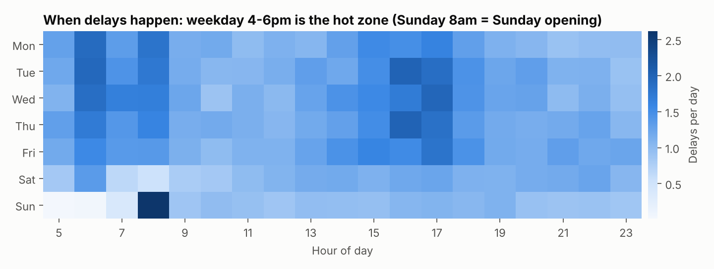

# TTC Subway Delay Predictor

How likely is a delay on the Toronto subway, at this station, at this hour, in this weather?

This project uses every delay the TTC logged from January 2023 to September 2026 (97,227 incidents, City of Toronto Open Data) plus hourly Toronto weather (Open-Meteo) to find out where and when delays happen, and to predict the risk of a delay of 5 minutes or more.

**Status: in progress.** Data cleaning and exploration are done; the model and app are next.

## First findings



- **Two daily peaks:** when service starts (6am weekdays, 8am Sundays) and the evening rush, 4-6pm, strongest Tuesday to Thursday.
- **Bloor-Yonge loses the most time** (about 12,000 delay minutes), followed by Kennedy, St George and Kipling: interchange and end-of-line stations.
- **Two thirds of lost time is caused by people, not machines:** passenger incidents (34%) and security incidents (33%). Track, signals and power are 18%.
- **Weather matters less than expected:** rain barely changes the delay rate (+4%); heavy snow (+37%) and deep cold (+31%) raise it, though heavy-snow hours are rare (41 hours).

More charts are in [`figures/`](figures/).

## Cleaning the data

The raw files needed real work before analysis:

| Problem | Fix |
|---|---|
| Station is free text cut at 22 characters: 1,687 spellings of about 75 stations | Longest-prefix matching to a list of real stations; 96% of incidents matched |
| Stations renamed mid-period: Dundas to TMU (2024), Eglinton West to Cedarvale (2025) | Mapped old names to current ones |
| Line field has 40+ spellings ("YU/BD", "YU / BD", "999") | Rule-based normalisation to Line 1, 2, 3, 4 or multi-line |
| 65% of incidents have a 0-minute delay | Treated as logged events, not delays |
| Planned closures logged as one 6+ hour "delay" | Flagged and excluded from delay statistics |
| 104 duplicate rows | Removed |

## Run it

```bash
pip install -r requirements.txt
python src/clean.py data_raw    # writes data/delays_clean.parquet
python src/eda.py               # writes the charts to figures/
```

## Data sources

- [TTC Subway Delay Data](https://open.toronto.ca/dataset/ttc-subway-delay-data/), City of Toronto Open Data, Open Government Licence - Toronto
- [Open-Meteo historical weather API](https://open-meteo.com/), CC BY 4.0

## Next

- Predict the chance of a 5+ minute delay by station, hour, weekday and weather; train on 2023-2025, test on 2026.
- A small app: pick a station and time, get the delay risk.
