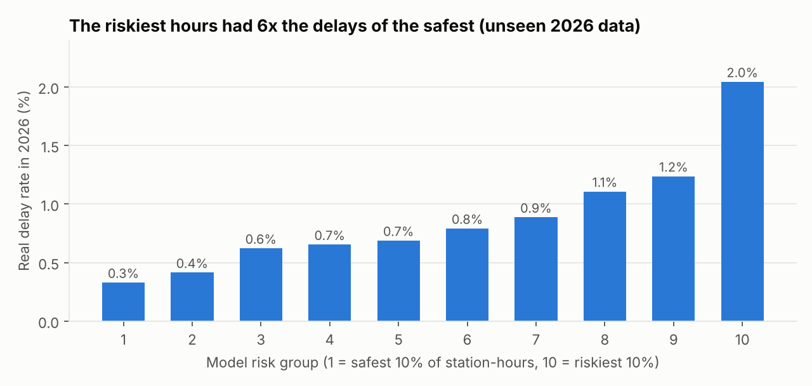

# TTC Subway Delay Predictor

How likely is a delay on the Toronto subway, at this station, at this hour, in this weather?

> **Result:** gradient boosting, trained on 2023-2025 and tested on unseen 2026 data, reaches **AUC 0.645**. Its riskiest 10% of station-hours had **6x the delay rate** of its safest 10%. Best features: **station**, hour of day, first hour of service. Weather adds almost nothing.

This project uses every delay the TTC logged from January 2023 to September 2026 (97,227 incidents, City of Toronto Open Data) plus hourly Toronto weather (Open-Meteo) to find out where and when delays happen, and to predict the risk of a delay of 5 minutes or more.

**Status: in progress.** Data cleaning, exploration and a first model are done; the app is next.

## First findings


- **Two daily peaks:** when service starts (6am weekdays, 8am Sundays) and the evening rush, 4-6pm, strongest Tuesday to Thursday.
- **Bloor-Yonge loses the most time** (about 12,000 delay minutes), followed by Kennedy, St George and Kipling: interchange and end-of-line stations.
- **Two thirds of lost time is caused by people, not machines:** passenger incidents (34%) and security incidents (33%). Track, signals and power are 18%.
- **Weather matters less than expected:** rain barely changes the delay rate (+4%); heavy snow (+37%) and deep cold (+31%) raise it, though heavy-snow hours are rare (41 hours).

More charts are in [`figures/`](figures/).

## The model

**Question:** at this station, in this hour, will there be a delay of 5+ minutes?

- **Grid:** every station x every passenger-service hour (6am-1am, Sundays from 8am), 1.5 million rows. Target = 1 if a 5+ minute delay was logged (closures excluded). Only 0.9% of rows are delays, so the score is AUC, not accuracy.
- **Features:** station, line, hour, weekday, month, a first-hour-of-service flag, temperature, precipitation, snowfall, wind.
- **Honest test:** trained on 2023-2025, tested on January-September 2026, which the model never saw. An earlier run (train 2023-2024, test 2025) gave nearly the same result (AUC 0.651), so the result holds across years.

| Model | AUC (2026) | Riskiest 10% of hours catch |
|---|---|---|
| Always predict the average | 0.500 | 11% of delays |
| Historical rate lookup (station x hour x day type) | 0.622 | 23% |
| Logistic regression | 0.644 | 22% |
| Gradient boosting | 0.645 | 23% |



**What this means**
- The model ranks risk well: its riskiest 10% of station-hours had **6x the delay rate** of its safest 10% (2.0% vs 0.3%), and its predicted probabilities match the real rates closely.
- But an AUC of 0.65 is modest, and that is the finding: most delays (disorderly passengers, ill customers, people on the track) are close to random at the level of one station in one hour. The model predicts *risk*, not incidents.
- **Station** carries almost all the signal, then hour of day and first hour of service. **Weather adds almost nothing** once those are known.
- A simple lookup table gets most of the way (0.622). Machine learning adds a small, real gain, which is worth saying plainly.
- At the **line level** (any 5+ minute delay on Line 1, 2 or 4 in an hour) the same approach reaches **AUC 0.72** on 2026: the network is more predictable than any one station.

## Cleaning the data

The raw files needed real work before analysis:

| Problem | Fix |
|---|---|
| Station is free text cut at 22 characters: 1,687 spellings of about 75 stations | Longest-prefix matching to a list of real stations; 96% of incidents matched |
| Stations renamed mid-period: Dundas to TMU (2024), Eglinton West to Cedarvale (2025) | Mapped old names to current ones |
| Line field has 40+ spellings ("YU/BD", "YU / BD", "999") | Rule-based normalisation to Line 1, 2, 3, 4 or multi-line |
| 65% of incidents have a 0-minute delay | Treated as logged events, not delays |
| Planned closures logged as one 6+ hour "delay" | Flagged and excluded from delay statistics |
| 104 duplicate rows | Removed |

## Run it

```bash
pip install -r requirements.txt
python src/clean.py data_raw    # writes data/delays_clean.parquet
python src/eda.py               # writes the charts to figures/
python src/model.py 2025 2026   # train on 2023-2025, test on 2026
cd src && python plot_model.py  # model charts
```

## Data sources

- [TTC Subway Delay Data](https://open.toronto.ca/dataset/ttc-subway-delay-data/), City of Toronto Open Data, Open Government Licence - Toronto
- [Open-Meteo historical weather API](https://open-meteo.com/), CC BY 4.0

## Next

- A small app: pick a station and time, get the delay risk.
